# TP-Link TD-W8963N Hardware Security Research

> **Authorization and scope:** This is a router I own and used for an isolated, authorized hardware-security study. I performed the work on my own device, without accessing other users’ networks, accounts, or subscriber traffic. Sensitive values in screenshots and configuration data have been redacted or omitted.

---

## 1. Opening the Router and Examining the Board

Upon opening the router, I spotted the RTL8676S processor and the GD25Q32C flash chip beside it. I also noticed the power-regulation area, which became useful later when I was identifying the UART pins. Looking at the board first gave me a map of the main components and possible places to investigate.

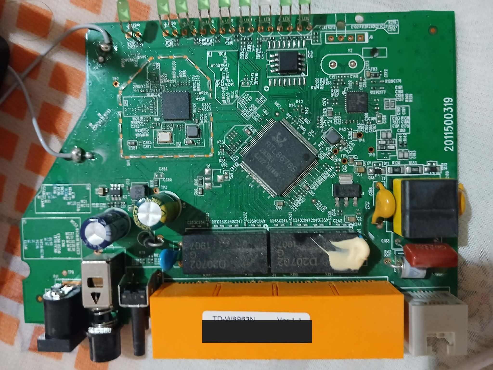

*Figure 1 — Board overview. The unit barcode and serial number are masked.*

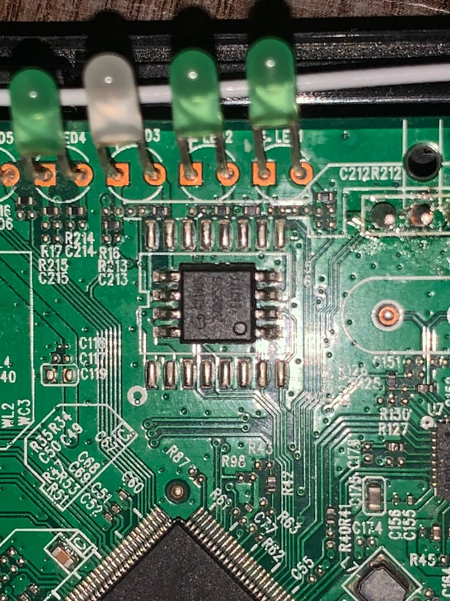

*Figure 2 — A closer view of the board area around an eight-pin component and nearby test points.*

## 2. Finding the UART and Establishing a Serial Connection

I suspected that the four pads were the UART connection. Before soldering, I used a multimeter to check continuity between the pads and nearby points on the board. Comparing them with the regulator output helped me identify the likely VCC pin; checking a known ground test point helped me identify GND. With the board powered, I confirmed the suspected ground connection measured 0 V against the board’s ground reference.

To distinguish the receive and transmit pins, I connected them to a logic analyzer and inspected the signal in the Saleae Logic software. The capture showed serial activity during startup, which confirmed my suspicion that these pads carried UART communication. I then soldered four wires and connected the router to my PC through a CP2102 USB-to-TTL serial adapter. I used the router’s own power supply.

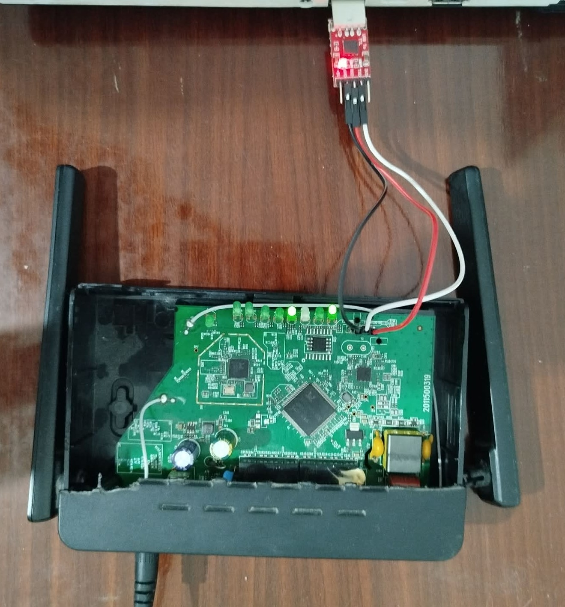

*Figure 3 — The router opened for serial-console work.*

## 3. Observing the Boot Messages and Investigating the UART Interface

After confirming the UART pins and their layout, I opened PuTTY with the CP2102 serial connection and booted the modem. A large amount of configuration and startup information appeared. The console also accepted input and displayed a vendor command interface. That showed me I had interactive access to the router’s embedded console; at this point, I was still investigating what level of access it provided.

The boot output identified the firmware as **TT_V2.0.0**, built on April 23, 2019. It also registered named tasks, including the CLI, PPPoE, DHCP, SNMP, and CWMP client tasks. These are observations from this unit’s boot log, not proof that the firmware has no Linux components.

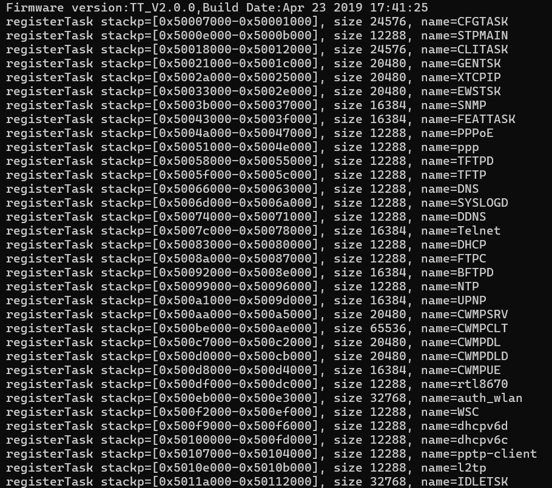

*Figure 4 — A cropped task-registration excerpt from the boot output.*

## 4. Locating the Hardware and Software Configuration Regions

While reading the boot output and trying to make sense of it, I noticed that the router reported separate hardware-configuration and software-configuration regions, along with their flash addresses, compressed lengths, and decompressed lengths. The hardware configuration contained device-specific information, while the software configuration held broader settings. Seeing those regions identified in the boot log made them worth examining in the flash image.

After initialization, the serial console displayed a password prompt. I tried the default passwords I knew about, but they did not work. Looking back at the configuration addresses in the boot log, I decided to check whether I could find and understand those regions directly in the flash dump.

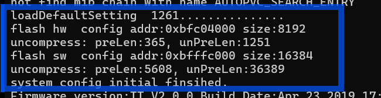

*Figure 5 — The boot output reports configuration addresses and compressed and decompressed lengths. These are memory-map details, not credentials.*

## 5. Reading the Firmware from the SPI Flash

The chip was identified as a GD25Q32C, a 32-Mbit SPI NOR flash device with a nominal capacity of 4 MB. SPI NOR flash is commonly used to store boot code, firmware, and device settings because it provides non-volatile storage that embedded processors can read through a relatively simple serial interface.

I used a CH341A USB programmer with a SOIC clip to read the flash. It should have been straightforward, but the low-quality clip kept slipping and interrupting the reads. I had to hold it in place by hand and repeat the extraction three times. I then compared the resulting MD5 hashes: the three dumps matched. That gave me confidence that the reads were consistent, although matching hashes alone do not prove that a dump is complete or authentic.

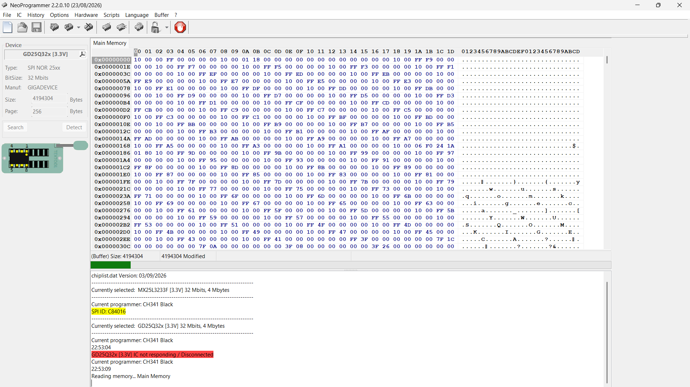

*Figure 7 — NeoProgrammer identifies the GD25Q32x family and shows a read attempt. This capture includes a disconnect; the matching-hash screenshot documents the later repeat reads.*

The programmer reported a 4,194,304-byte buffer for the 32-Mbit chip. The bootloader separately printed “Flash Size: 16M” without defining the unit. I have not resolved that difference, so I treat the matching hashes as evidence of repeatability, not by themselves as proof of a complete full-chip image.

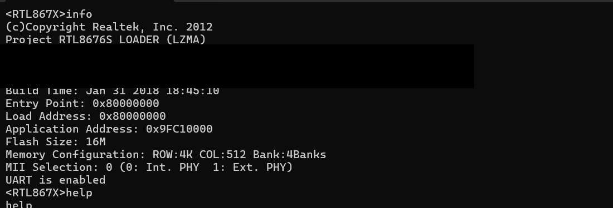

*Figure 8 — The bootloader information includes a flash-size report and indicates that UART is enabled. The hardware MAC line is concealed.*

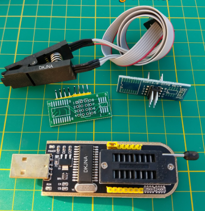

*Figure 9 — The CH341A programmer, clip, and adapters used for the flash read.*

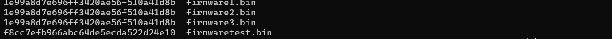

*Figure 10 — Three reads produced matching hashes, providing a consistency check.*

---

## 6. Inspecting the Firmware Image

After obtaining consistent reads, I inspected the image to understand its structure and learn more about what was running on the RTL8676S. I used Binwalk to scan for recognizable data. The output showed many regions identified as LZMA-compressed data, with properties beginning `0x5D`, as well as embedded JPEG, GIF, and PNG assets.

The repeated LZMA detections made me curious about how the compression was structured and whether the configuration regions from the boot log used the same format. A scan is a useful starting point, but it does not by itself identify every region or establish the complete firmware architecture.

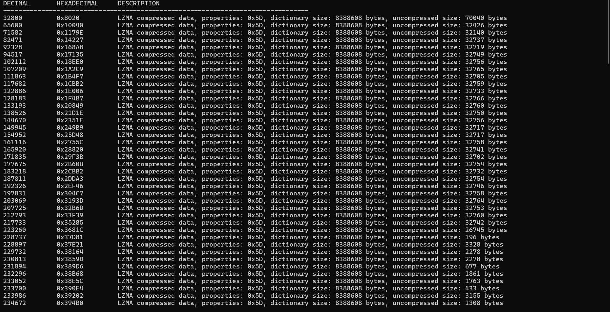

*Figure 11 — A representative excerpt of Binwalk’s LZMA detections.*

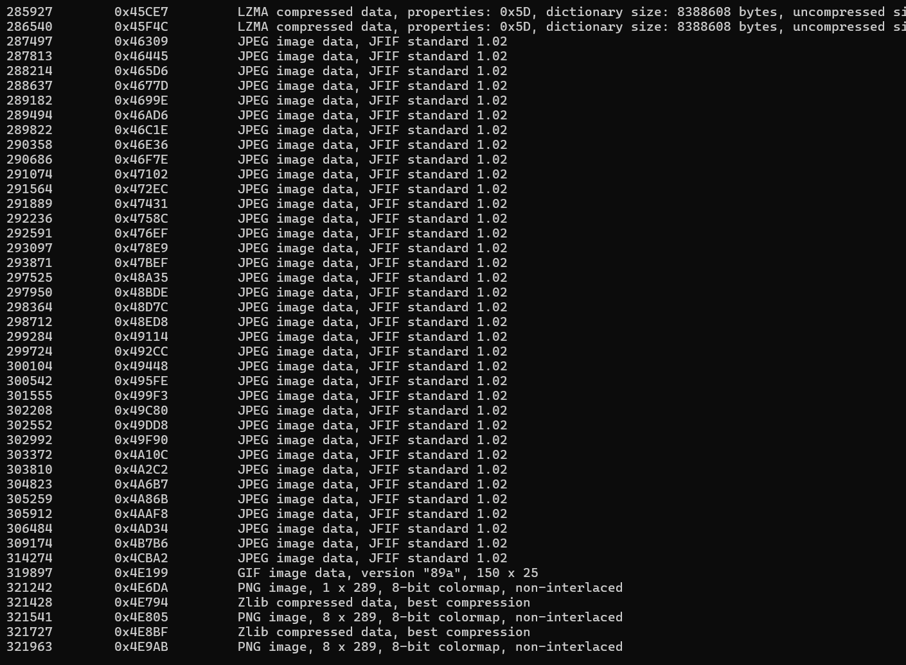

*Figure 12 — Binwalk also identified image resources embedded in the firmware.*

---

## 7. Learning LZMA and Decompressing the Configuration Data

After learning the basics of LZMA, I returned to the two configuration regions I had found in the boot output. Their data used a vendor-specific wrapper: it included an outer header and LZMA properties, but did not include the uncompressed-size field expected by the LZMA-alone format. Because a normal decoder needs that size, I wrote a small Python utility to rebuild the LZMA-alone header using the size reported by the router, then pass the reconstructed stream to Python’s `lzma` module.

Before decompressing the blocks, I compared their bytes in hex. The headers and payloads did not look like plain-text configuration, which pushed me to inspect the wrapper and reconstruct the fields the decoder needed.

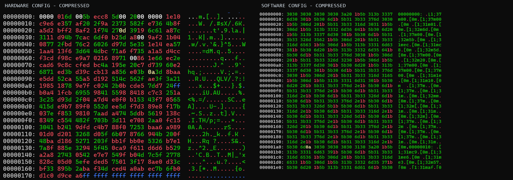

*Figure 13 — Side-by-side hex views of the compressed hardware- and software-configuration blocks.*

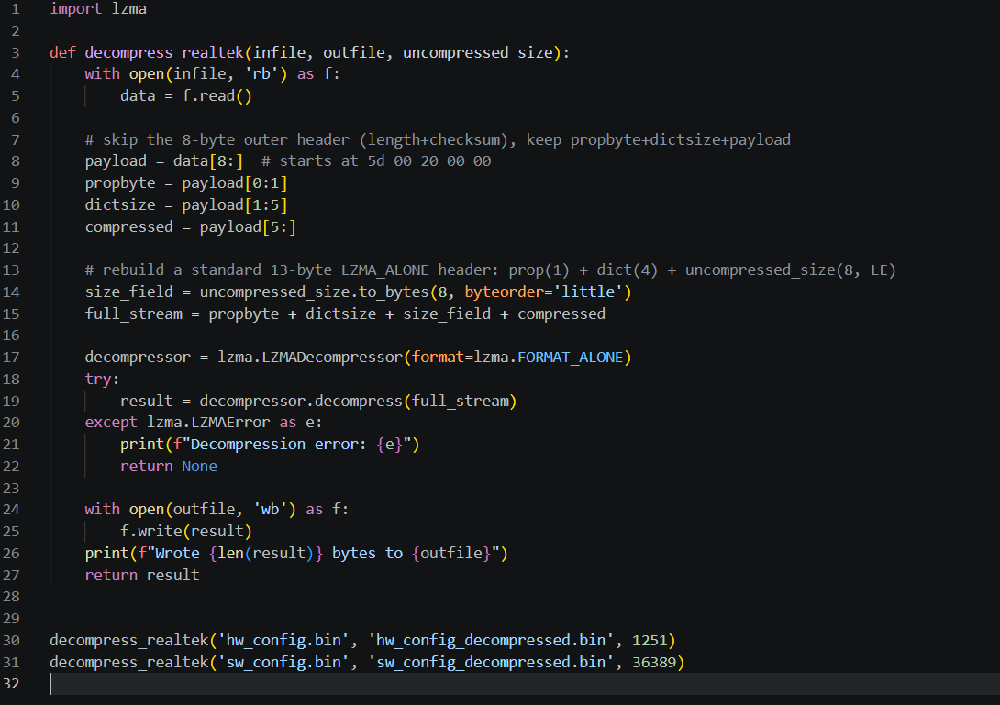

*Figure 14 — The script skips the outer wrapper and rebuilds the LZMA-alone header with the uncompressed size reported by the router.*

The decompression produced separate hardware- and software-configuration files with output lengths matching the boot log. When I inspected the decoded data, I found readable, XML-like configuration entries. They included device and wireless settings, along with three account privilege levels. The associated credential values are deliberately not shown here.

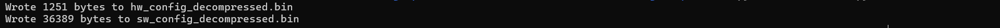

*Figure 15 — The script wrote decompressed configuration files with lengths matching the startup output.*

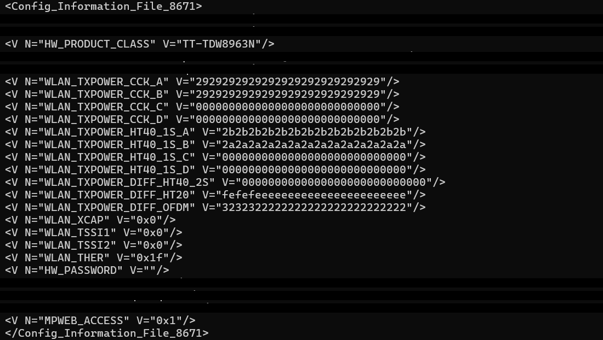

*Figure 16 — A decoded hardware-configuration excerpt. Identity and credential-bearing rows are concealed.*

---

## 8. Reviewing Privilege Levels and Stored Authentication Data

The configuration contained three account levels with different privilege assignments: a standard user level, an administrative level, and a highest-privilege level identified by the firmware as superadmin. The data also showed that authentication material was stored in a readable form in the configuration. I am not reproducing the usernames, passwords, wireless keys, WPS PIN, or provider credentials, since those values can be sensitive and may be reused.

This was the point where the configuration findings connected back to the password prompt I had seen over UART. I have concealed the username and password values in the screenshot while leaving the privilege and level fields visible.

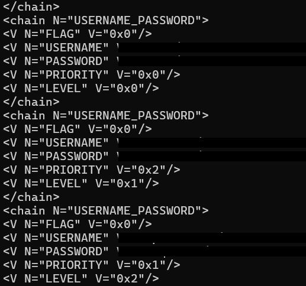

*Figure 17 — The three account entries and their privilege/level fields; usernames and passwords are masked.*

---

## 9. Reconnecting to the Router and Verifying Privileged Access

I returned to the serial console and authenticated using the highest-privilege account recovered from my own router’s configuration. The console accepted authentication and showed a `$` prompt. Its help output lists `sh` as the command to enter shell mode, while a trial `ls` command was rejected and returned the vendor’s command list. I describe this as access to the router’s highest-privilege vendor interface; the screenshot does not establish a general-purpose Linux shell.

This confirmed that the recovered account corresponded to a higher privilege level in the device’s console. The password itself is omitted.

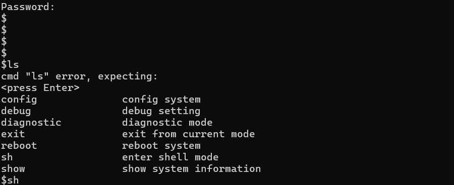

*Figure 18 — The authenticated prompt and vendor command help. No password is shown.*

---

## 10. Reaching the ADSL Shell Prompt

After authentication, I used the `sh` command, which the interface help describes as entering shell mode. The prompt changed to `ADSL#`. I tested `ls`, but the router rejected it as an unknown command and displayed its supported vendor commands. This confirmed access to the ADSL command environment, while also showing that it was not a conventional Linux shell.

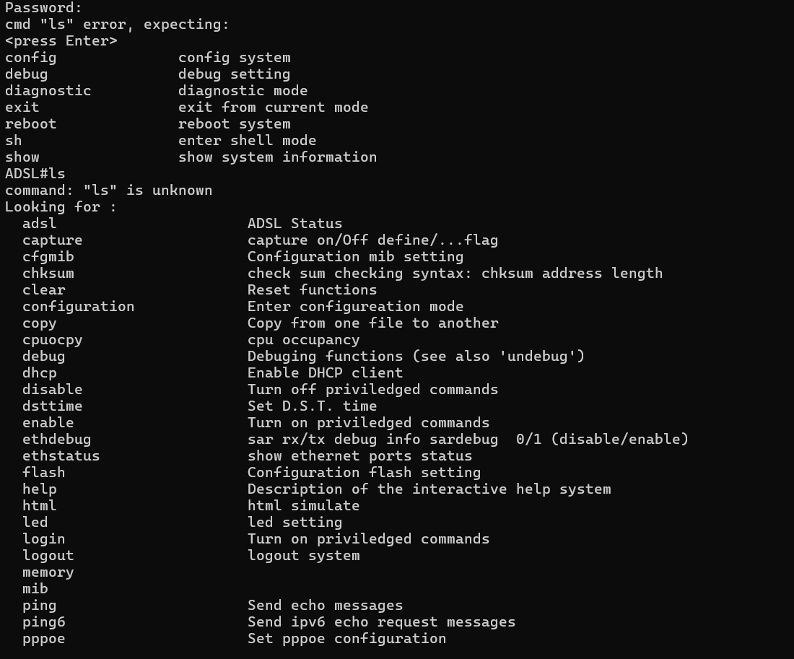

*Figure 19 — The `ADSL#` prompt and vendor command list. The attempted `ls` command is rejected; no password is shown.*

## 11. The Investigation in Brief

I started by opening my TD-W8963N and identifying its main chips, then used a multimeter and logic analyzer to locate and confirm the UART interface. The boot log exposed the firmware version and configuration-region metadata. I read the SPI flash three times with a CH341A and compared the hashes, inspected the image with Binwalk, and wrote a Python utility to decompress the vendor-wrapped LZMA configuration blocks. The decoded configuration revealed readable authentication data across several privilege levels, which I used to verify higher-privilege access to the router’s own vendor console. I have redacted credentials and identifiers from the publication copy.

---

## 12. Security Impact and Responsible Disclosure

The main security concern I observed is that a person with physical access to this router and the ability to read its flash could recover configuration data that included readable authentication material. The serial console also provided an interactive vendor interface. Together, these findings make physical access a meaningful security boundary for this unit: possession of the device may expose credentials and privileged functions that should be protected or changed before reuse.

This work did not demonstrate a remote exploit, access to another person’s network, or that credentials are shared across other units or service-provider accounts. I have not established the behavior of other hardware revisions or firmware builds. The evidence supports a local exposure on the device I tested, not a claim that every TD-W8963N is remotely vulnerable. A practical mitigation would be to avoid storing reusable secrets in recoverable form, restrict or authenticate production debug interfaces, and ensure service credentials are unique and rotated when equipment changes hands.

---

**Tags:** Hardware Security · Embedded Systems · Firmware Analysis · UART · SPI Flash · Realtek · Tunisia

*All work was performed on personally owned hardware for educational purposes. No third-party network, account, or live subscriber traffic was accessed.*

