# Securinets Quals — Gelato

## Scenario

A small gelateria owner has misplaced the password to a protected file containing the shop’s signature recipe. The recipe is stored on the machine that runs the gelato system, and the owner has provided a forensic disk image for recovery. Our task is to follow the clues left on the disk, recover the password, and retrieve the recipe’s contents without modifying the original image.

The supplied image was **Gelatino.img**. I worked from Windows with Autopsy and used WSL for command-line analysis, Python, and Linux disk tools.

## Investigation outline

The image had a GPT partition table. The main data partition was LUKS-encrypted, so Autopsy could not ingest its contents directly. The adjacent EFI partition was readable, and its bootloader contained the logic for decoding a small custom-packed file. Decoding that file revealed a flavor list and sales log. Those clues supplied a passphrase pattern; testing the likely ticket numbers identified the LUKS passphrase. The unlocked filesystem contained an OpenSSL-encrypted recipe, which produced the flag when decrypted.

## Tools used

- **Autopsy 4.23.1** to create the case and examine the image’s partition and file structure.
- **Sleuth Kit (mmls)** to read the GPT layout and calculate partition offsets.
- **WSL utilities** including file, xxd, 7z, binwalk, cpio, losetup, cryptsetup, and OpenSSL.
- **Binary Ninja Free** to inspect the EFI loader’s efi_main function.
- **Python 3** to reproduce the loader’s byte transform and test candidate LUKS passphrases.

## 1. Open the image and map its partitions

The initial file-type check reported a DOS/MBR boot sector with partition type 0xee, the protective MBR used with GPT. Autopsy then showed that ingest had stopped on the gelato-data partition because it was LUKS-encrypted. I used mmls to get the authoritative GPT partition table and exact sector offsets.

~~~text
$ mmls Gelatino.img
GUID Partition Table (EFI)
Units are in 512-byte sectors

Slot  Start     End       Length    Description
004   00002048  000206847 000204800 gelato-data
005   000206848 000264191 000057344 EFI
~~~

The data partition starts at sector 2048. At 512 bytes per sector, that is byte offset 1,048,576 (1 MiB). Its length is 204,800 sectors, or 104,857,600 bytes (100 MiB). The EFI partition starts immediately after it, at sector 206,848.

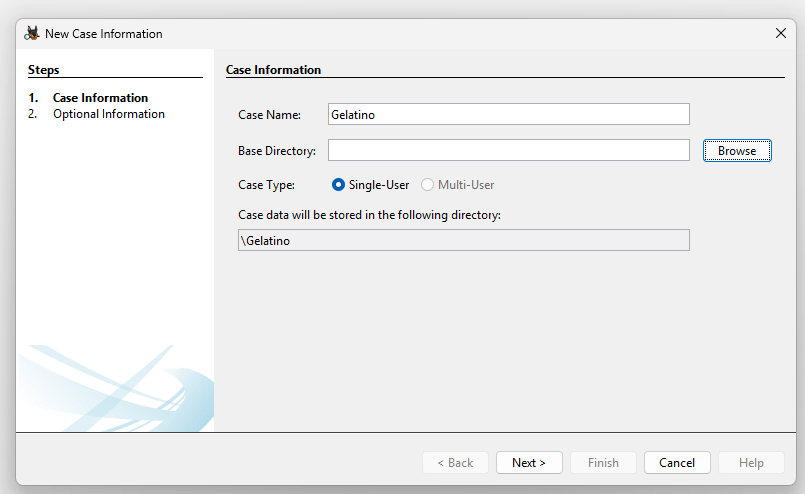

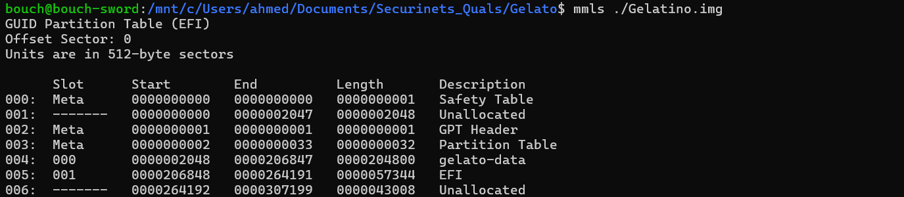

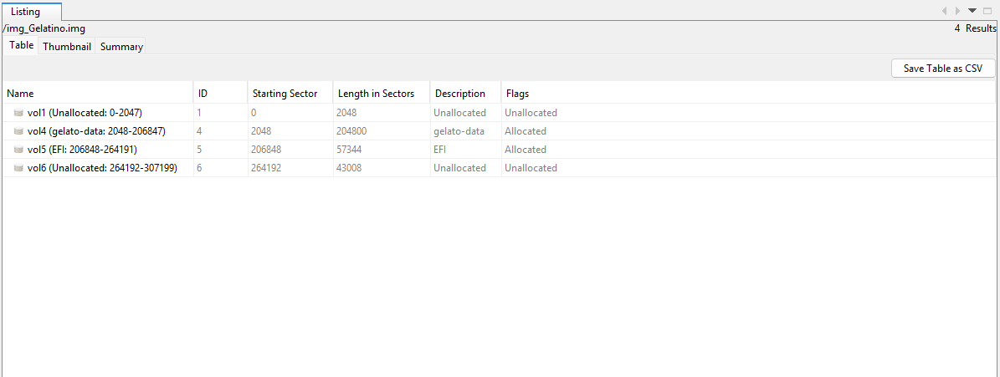

### **Why choose vol5 specifically?**

In Autopsy, **vol5** is the EFI partition, beginning at sector 206,848. It is a small, readable EFI volume and contains the boot files and the jukebox directory. **vol4** is the gelato-data partition, which Autopsy identified as LUKS-encrypted and could not browse yet. So vol5 was the accessible place to look for clues about how the machine used its encrypted data. The volume number is Autopsy’s label; the partition’s start sector and description are what identify it.

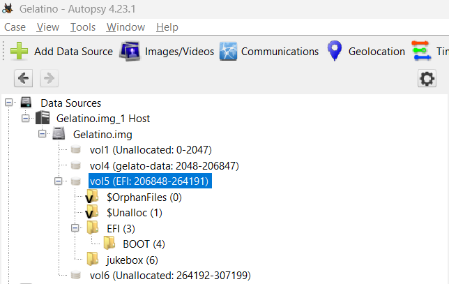

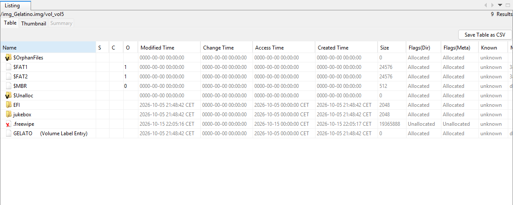

## 2. Find the custom-packed startup file

The EFI volume contained EFI/BOOT and jukebox. In EFI/BOOT were BOOTX64.EFI and GRUBX64.EFI; jukebox contained memdisk.pack and other files. The deleted _OTE.txt entries did not provide a useful lead. The packed file was only 2,064 bytes, so it was practical to inspect directly.

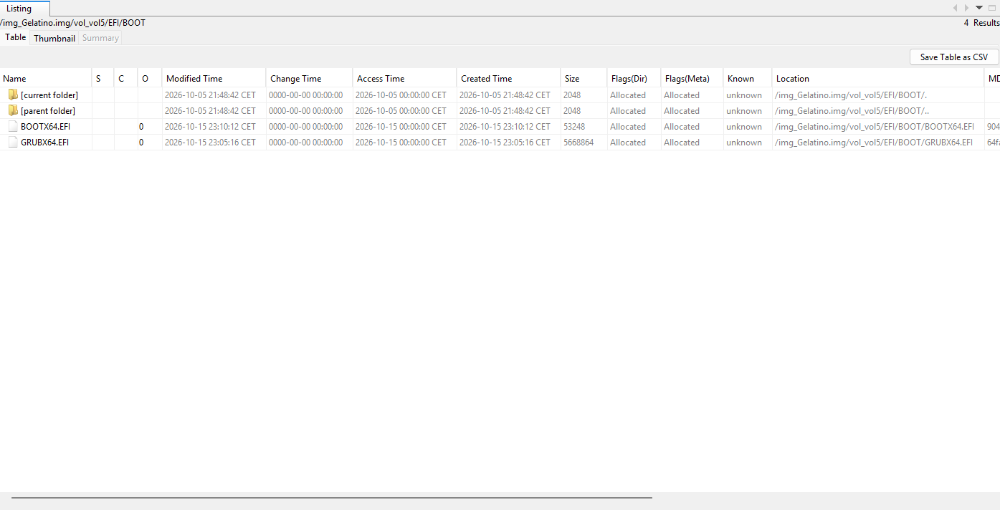

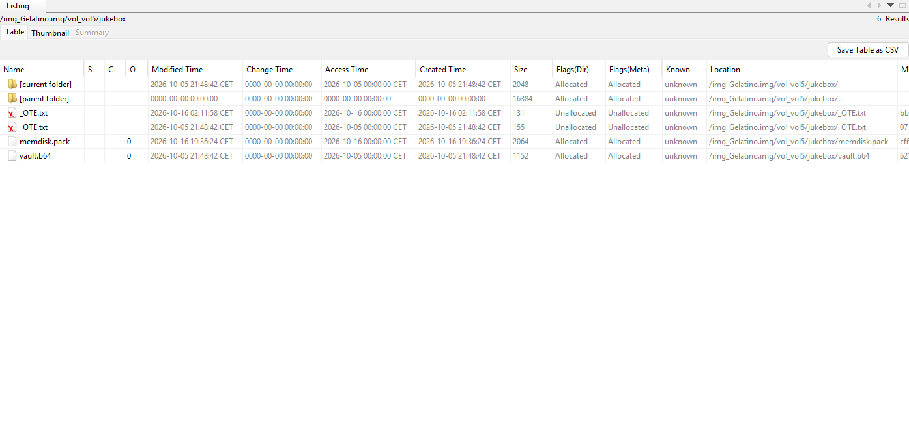

The first checks did not identify memdisk.pack as a standard archive:

~~~text
$ file memdisk.pack
memdisk.pack: data

~~~

A hex view showed the four-byte marker GLT1 at the beginning of the file. That suggested a custom container, so I checked how the EFI program loaded it.

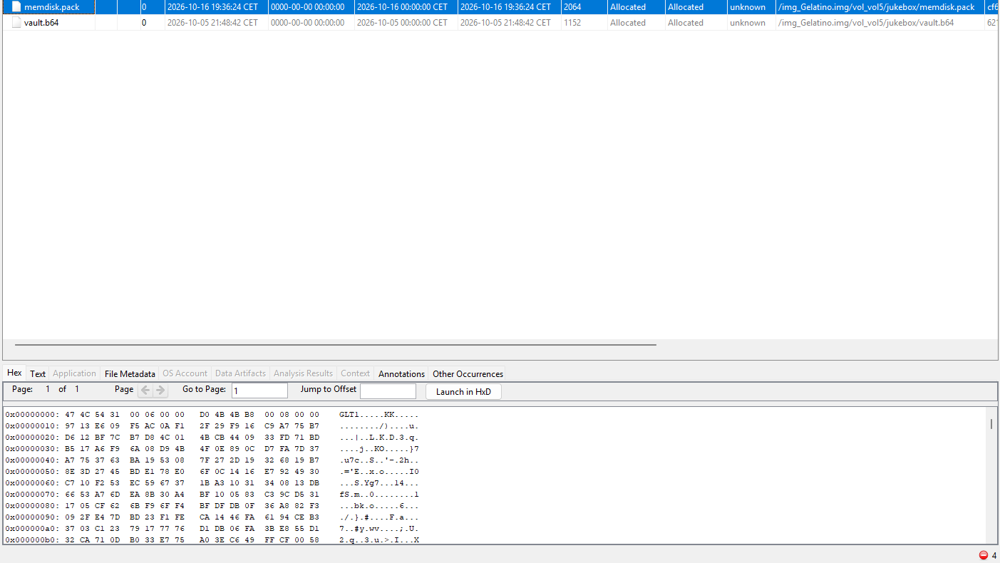

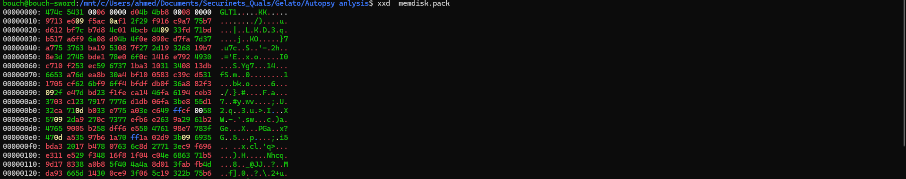

## 3. Reverse the loader’s transform

file identified BOOTX64.EFI as an x86-64 EFI application. I opened it in Binary Ninja and inspected efi_main. The function contains the path \\jukebox\\memdisk.pack, reads that file, checks for GLT1, parses three little-endian 32-bit values, decodes the payload, checks the decoded data’s CRC32, and expects the result to begin with the CPIO magic 070701.

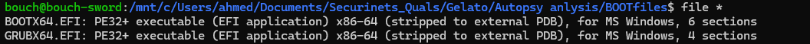

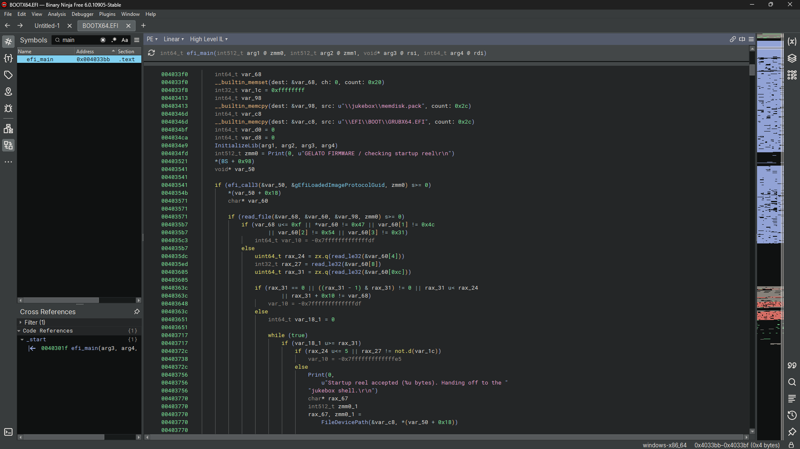

The header fields are:

- Decoded output size: **1536 bytes**
- Expected CRC32: **0xb8b44bd0**
- Encoded payload span: **2048 bytes**

The file length confirms the layout: a 16-byte header followed by a 2,048-byte payload, for 2,064 bytes total. The decoder’s byte transform, transcribed from the loader and checked against its CPIO magic and CRC, is:

~~~text
decoded[i] =
    ((i * 0x3d - 0x59) & 0xff)
    XOR ROR8(payload[(i * 0x0d) % span], i & 7)
~~~

The following Python reproduces the transform and saves the result only if the CRC matches:

~~~python
from pathlib import Path
import struct
import zlib

blob = Path("memdisk.pack").read_bytes()
size, expected_crc, span = struct.unpack_from("<III", blob, 4)
payload = blob[16:]

def ror8(value, count):
    count &= 7
    return ((value >> count) | (value << (8 - count))) & 0xff

decoded = bytes(
    ((i * 0x3d - 0x59) & 0xff)
    ^ ror8(payload[(i * 0x0d) % span], i)
    for i in range(size)
)

actual_crc = zlib.crc32(decoded) & 0xffffffff
print(f"expected CRC=0x{expected_crc:08x}, actual CRC=0x{actual_crc:08x}")

if actual_crc != expected_crc:
    raise SystemExit("CRC mismatch; not saving output")

Path("memdisk.cpio").write_bytes(decoded)
print("Saved verified output: memdisk.cpio")
~~~

The quick header check reconstructed the expected first six bytes, 070701. The full decode then produced the same CRC32 as the header, confirming that the output was valid rather than merely plausible-looking data.

~~~text
size=1536, checksum=0xb8b44bd0, span=2048
first six bytes: b'070701' 303730373031

expected CRC=0xb8b44bd0, actual CRC=0xb8b44bd0
Saved verified output: memdisk.cpio
~~~

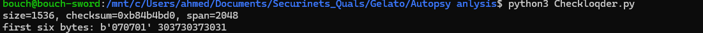

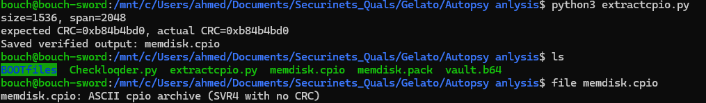

## 4. Read the CPIO clues

file identified memdisk.cpio as an SVR4 ASCII CPIO archive without a CRC field. binwalk found two members, blends.lst and order_history.txt, followed by the CPIO trailer. Listing the archive confirmed their sizes: 381 and 722 bytes.

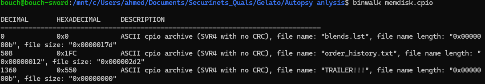

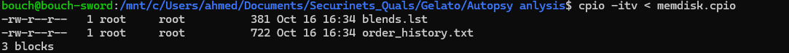

I printed both files in one command:

~~~bash
cpio -i --to-stdout blends.lst order_history.txt < memdisk.cpio
~~~

The flavor list contains the clue:

~~~text
Mmm... pistachio was always the owner's favorite.
The register wrote tickets as flavor-ticket number.
~~~

The order history identifies the owner’s order:

| Name | Time | Flavor |
|---|---:|---|
| Molly Carter | 10:12 | vanilla |
| Ethan Brooks | 10:48 | lemon |
| Lucy Bennett | 11:05 | blueberry |
| Oliver Hayes | 11:36 | caramel |
| Grace Foster | 12:14 | mango |
| Noah Reed | 12:59 | coffee |
| Chloe Parker | 13:21 | cotton-candy |
| Henry Ward | 13:50 | hazelnut |
| Ava Collins | 14:07 | chocolate |
| Liam Price | 14:42 | peach |
| Emma Lawson | 15:11 | strawberry |
| Jack Morgan | 15:46 | matcha |
| Sophie Miller | 16:08 | tiramisu |
| Daniel Scott | 16:39 | orange |
| Ella Cooper | 17:03 | yuzu |
| Samuel Gray | 17:29 | coconut |
| Mia Turner | 17:54 | passionfruit |
| **Filip The Owner** | **18:16** | **pistachio** |
| Max Sullivan | 19:02 | raspberry |
| Lily James | 20:27 | walnut |

Together, the owner’s pistachio clue and the “flavor-ticket number” note suggested testing passphrases of the form **pistachio-<number>**. The exact number was not stated in the files, so I checked candidates against the LUKS volume itself.

## 5. Test the ticket number against LUKS

I created a read-only loop device for the encrypted partition. The offset and size come directly from the GPT table:

~~~bash
sudo losetup --find --show --read-only \
  --offset 1048576 --sizelimit 104857600 \
  /mnt/c/Users/ahmed/Documents/Securinets_Quals/Gelato/Gelatino.img
~~~

The command returned /dev/loop0. The Python script tested each candidate with cryptsetup’s --test-passphrase option. This checks whether a passphrase unlocks the LUKS keyslot without creating a decrypted mapping.

~~~python
import subprocess

device = "/dev/loop0"

for ticket in range(1, 101):
    candidate = f"pistachio-{ticket}"
    result = subprocess.run(
        [
            "cryptsetup", "open", "--type", "luks",
            "--test-passphrase", "--key-file=-", device,
        ],
        input=candidate.encode(),
        stdout=subprocess.DEVNULL,
        stderr=subprocess.DEVNULL,
    )

    if result.returncode == 0:
        print(f"MATCH: {candidate}")
        break
else:
    print("No match among tickets 1–100.")
~~~

Running this python file gave : 

~~~text
MATCH: pistachio-37
~~~

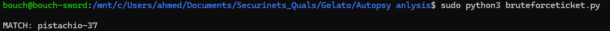

## 6. Unlock and inspect the filesystem read-only

I opened the LUKS volume read-only and entered pistachio-37 at the prompt:

~~~bash
sudo cryptsetup open --type luks --readonly /dev/loop0 gelato_data
lsblk -f /dev/mapper/gelato_data
~~~

lsblk reported an **ext2** filesystem labeled **recipe**. I mounted the mapped device read-only and listed its root directory. It contained lost+found and one relevant file, recipe.enc.

~~~bash
sudo mkdir -p /mnt/gelato_data
sudo mount -o ro /dev/mapper/gelato_data /mnt/gelato_data
ls -la /mnt/gelato_data
~~~

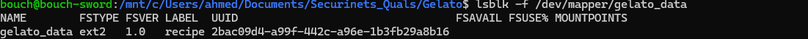

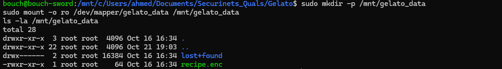

## 7. Decrypt the recipe

file described recipe.enc as OpenSSL encrypted data with a salted password. The hex view begins with Salted__, OpenSSL’s salted-file marker. With the passphrase already established, I tried AES-256-CBC using OpenSSL’s legacy default key derivation:

~~~bash
openssl enc -d -aes-256-cbc \
  -in /mnt/gelato_data/recipe.enc \
  -pass pass:pistachio-37
~~~

OpenSSL printed a warning that the legacy key derivation is deprecated, then successfully decrypted the file to standard output. The resulting text had the expected Securinets flag format:

**Flag:** **Securinets{n3xt_time_buy_s0m3th1ng_h34lthy}**

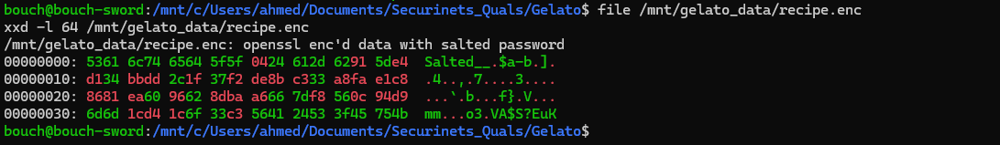

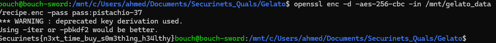

## Conclusion

The EFI bootloader was the bridge between the encrypted partition and its password clue. Reversing its custom GLT1 transform recovered a CPIO archive; the archive pointed to pistachio and explained the flavor-ticket pattern. Cryptsetup confirmed ticket 37 as the LUKS passphrase, which exposed the ext2 recipe volume. Decrypting recipe.enc recovered the flag.

The original disk image and the decrypted filesystem were accessed through read-only loop and mount options during the Linux-side inspection.

